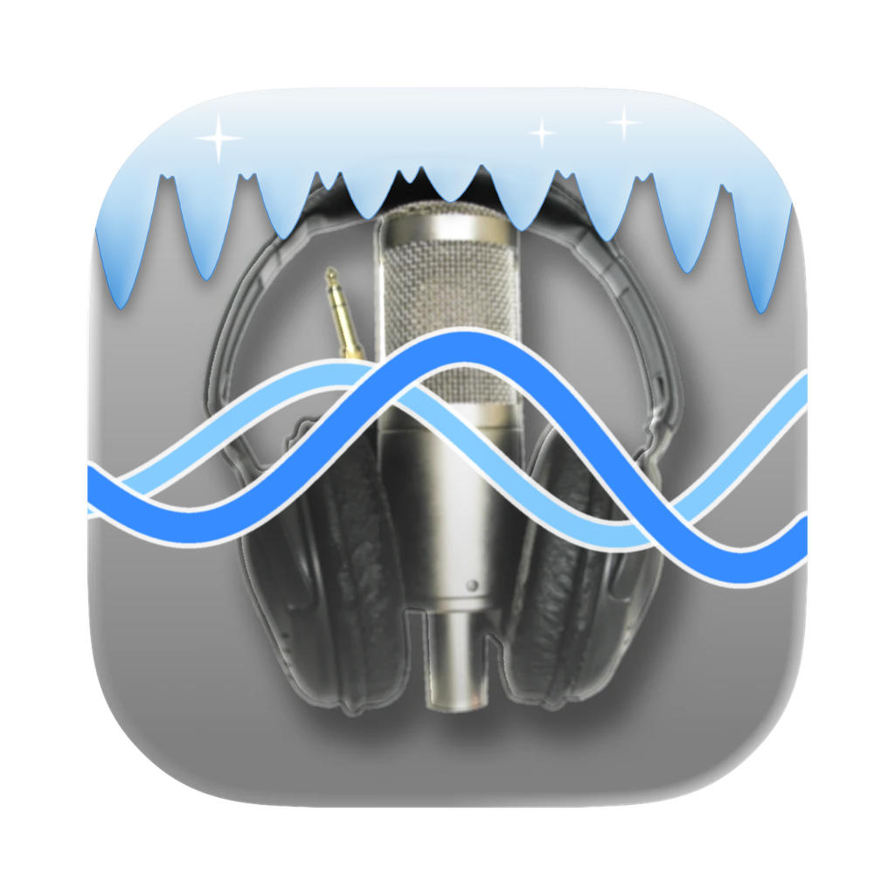

<p align="center"></p>

# LogiKast

**Version 1.1b1 (beta)**

*LogiKast was called iceKast in its first beta.*

A free macOS app that makes running an [Icecast](https://icecast.org) streaming server easy.
Built for Radiologik users, but works with any Icecast-compatible encoder, such as [Audio Hijack](https://rogueamoeba.com/audiohijack/), [LadioCast](https://apps.apple.com/us/app/ladiocast/id411213048), [BUTT](https://danielnoethen.de/butt/) and [BUTTM](https://buttm.app).
Icecast is bundled; nothing else needs to be installed. MP3, AAC and HE-AAC streams.

- One Icecast server with any number of mounts; per-mount max listeners, burst size, fallback and stream info
- Live status per mount, with listener counts in the Dock badge and the menu bar
- The server runs in the background: it keeps running when LogiKast is closed, restarts if it stops, and starts at login
- Copy-and-paste connection details for your encoder, and a setup assistant for new stations
- Listener list with search and a Disconnect button, per-stream and total bandwidth, and a button for Icecast's web admin
- Backup audio that plays when the encoder drops and hands back to live when it returns: choose any audio file (MP3, AAC, M4A, WAV, AIFF, FLAC...) and LogiKast converts it to your stream's format, or use another mount or a stream from another server
- Relay: a mount can take its audio from another Icecast or Shoutcast server instead of an encoder, and other servers can relay your mounts
- Share links, QR code and website player code; optional public directory listing
- macOS 13 or later, Apple silicon and Intel

## Relaying

- **A mount that relays another server:** on a mount's Connect tab, set *Audio from* to *Another Icecast server* and enter the server, port, mount and (if it asks) a login. No encoder is needed. LogiKast retries a lost relay every 15 seconds.
- **Backup from another server:** on the Backup tab, a mount can switch its listeners to a stream from another server when its own source drops, and back again when it returns.
- **Relaying a mount of yours:** another Icecast server only needs the address on the mount's Advanced tab. It listens to the mount like a listener (counting as one) and needs no password.
- **Relaying everything from another server:** Server › Relay can also take every visible mount from another Icecast server (it needs that server's relay password), under the same names, and picks up new ones within about 20 seconds. Changing or turning this off needs a server restart.
- **Relaying all your mounts at once:** Server › Relay turns on Icecast's master/slave relaying, which needs a password the other server enters (user "relay"). Hidden backup mounts are not shared.

## Building

Requires Xcode, and `xcodegen` (`brew install xcodegen`) to generate the Xcode project (it is generated from `project.yml` and not checked in).

Run these one at a time. Don't paste the `#` comments into Terminal: zsh doesn't treat them as comments, and they would be passed to the script as extra arguments.

```bash
# 1. Build the universal static Icecast into build/icecast
scripts/build-icecast.sh
```

```bash
# 2. Build the LAME MP3 encoder into build/lame (LogiKast uses it to convert backup audio to MP3)
scripts/build-lame.sh
```

```bash
# 3. Create LogiKast.xcodeproj from project.yml
xcodegen generate
```

```bash
# 4. Build, then test
xcodebuild -project LogiKast.xcodeproj -scheme LogiKast -derivedDataPath build/xcode build
xcodebuild -project LogiKast.xcodeproj -scheme LogiKast -derivedDataPath build/xcode test
```

## Working on the code

After the build steps above, open `LogiKast.xcodeproj` in Xcode. The project file is generated from `project.yml` and isn't checked in, so change targets and settings in `project.yml`, then run `xcodegen generate` again.

Where things are:

| Folder | What's in it |
|---|---|
| `LogiKast/Views` | The SwiftUI screens: the window, the mount and server pages, the setup assistant |
| `LogiKast/Model` | Settings, the Icecast configuration writer, validation and status parsing. Plain logic with tests |
| `LogiKast/Services` | Everything that talks to the outside: the Icecast server job, its admin interface, network checks, backup audio files |
| `Feeder` | The small helper that streams a backup audio file to the server |
| `Launcher` | The tiny program launchd runs to keep Icecast and the feeder going |
| `LogiKastTests` | Unit tests, plus tests that render every screen to images |
| `third_party`, `scripts` | The pinned Icecast and LAME sources with LogiKast's patches, and the build and release scripts |

**Seeing a screen without running the app.** Each file in `LogiKast/Views` ends with `#Preview` blocks. Open the file, then choose Editor › Canvas (⌥⌘↩) to see its screens with sample data. The sample data is in `Views/Previews.swift`. Previews use a temporary folder, so they never touch your settings or a running server.

**Tests.** Press ⌘U, or run `xcodebuild test`. To save pictures of every screen for a visual check, set `TEST_RUNNER_LOGIKAST_SNAPSHOT_DIR` to a folder when running the tests.

**Running a development build** uses your real settings, and the server it starts keeps running in the background after you quit. Stop it from the app's Server button first if you want a clean start.

Please use U.S. English spelling in the interface and comments. LogiKast is GPLv2, and contributions are accepted under the same license.

## Updates (Sparkle)

LogiKast updates itself with [Sparkle](https://sparkle-project.org) 2.10.0: automatic checks, **Check for Updates…** in the LogiKast menu, and a switch for beta versions under Server › App & Log. Final releases come from `https://macinmind.com/pads/LogiKast.xml`; the beta feed, `https://macinmind.com/pads/LogiKastbeta.xml`, lists betas and finals. Update files are signed with an EdDSA key (the public half is `SUPublicEDKey` in `project.yml`; the private half is in the release manager's keychain).

To publish an update, after `scripts/package.sh --notarize` and creating the GitHub release:

```bash
scripts/make-appcast.py add build/release/LogiKast-<version>.dmg --channel beta --notes "What's new" --notes "Another change"
```

That signs the DMG, records it in `appcast/releases.json`, and rewrites `appcast/LogiKast.xml` and `appcast/LogiKastbeta.xml`. Upload both files to `https://macinmind.com/pads/`.

## Versioning

The public version (`CFBundleShortVersionString`) is the one people see: `1.0b3`, `1.0b4`, then `1.0`, `1.1b1`, and so on.
The build number (`CFBundleVersion`) is a single whole number that goes up by 1 for every build that is handed out
(including a re-notarized rebuild of the same public version) and never repeats. Sparkle compares the build number, not
the public version. Both are set in `project.yml`.

## Credits

LogiKast runs [Icecast](https://icecast.org), the open source streaming server from the Xiph.Org Foundation and its contributors (GPLv2). It also bundles libxml2, libxslt, libogg, libvorbis, libigloo, curl, RHash and the LAME MP3 encoder, each under its own license. The licenses and notices are in [LogiKast/Resources/ThirdPartyNotices.txt](LogiKast/Resources/ThirdPartyNotices.txt) and in the app's About window. The exact versions, the five small patches applied, and the build recipe are in `third_party/`, `scripts/build-icecast.sh` and `scripts/build-lame.sh`.

## License

The source code is GPLv2, same as Icecast. See [LICENSE](LICENSE).

The LogiKast icon is derived from the Radiologik icon and is © MacinMind Software, Inc. All rights
reserved. It is **not** covered by the GPL; please don't reuse it without permission.
